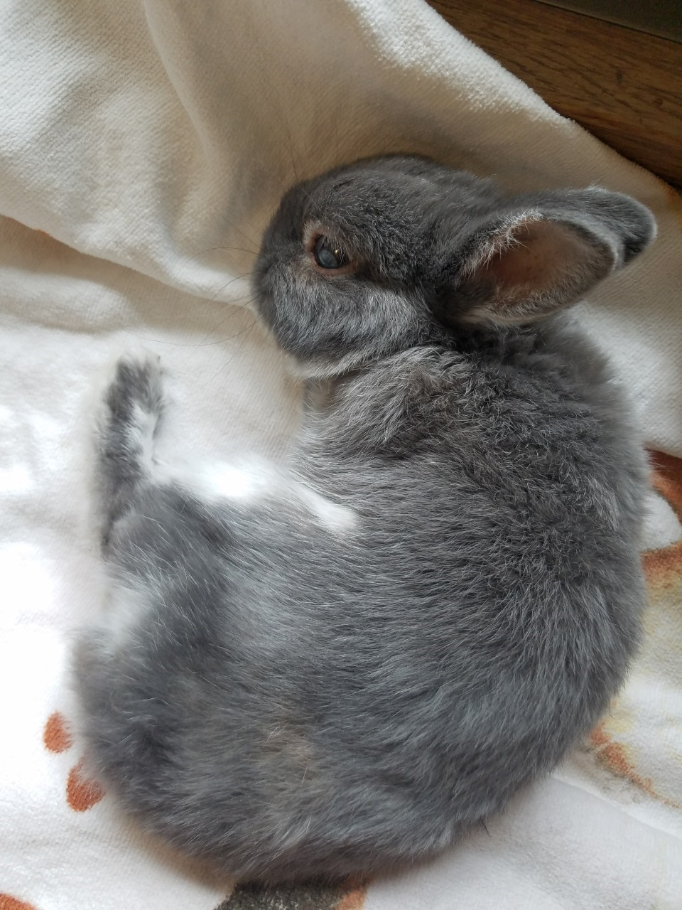

::: {.columns}

::: {.column width="50%"}
{style="border-radius: 16px; width: 70%;"}
:::

::: {.column width="50%"}

## Soyoka Okamura  {.index-title}

soyoka802@gmail.com

[cv](files/cv-soyoka.pdf){target="_blank" rel="noopener" .btn .btn-primary .btn-cv}

Hi! I'm Soyoka, a PhD student in Economics at Northwestern University. 

My research examines (i) how market in developing countries does (does not) works, and (ii) development corporation.

:::
:::
